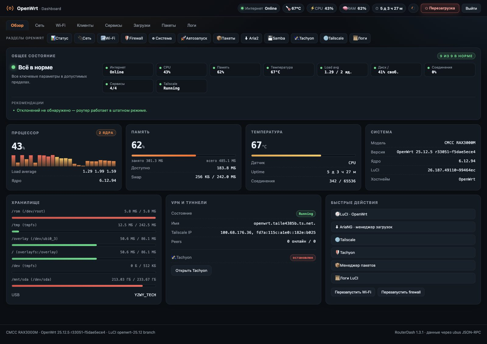
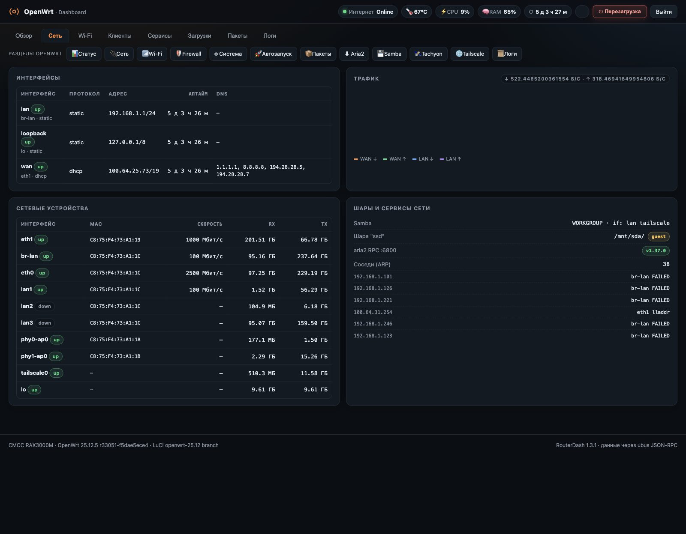
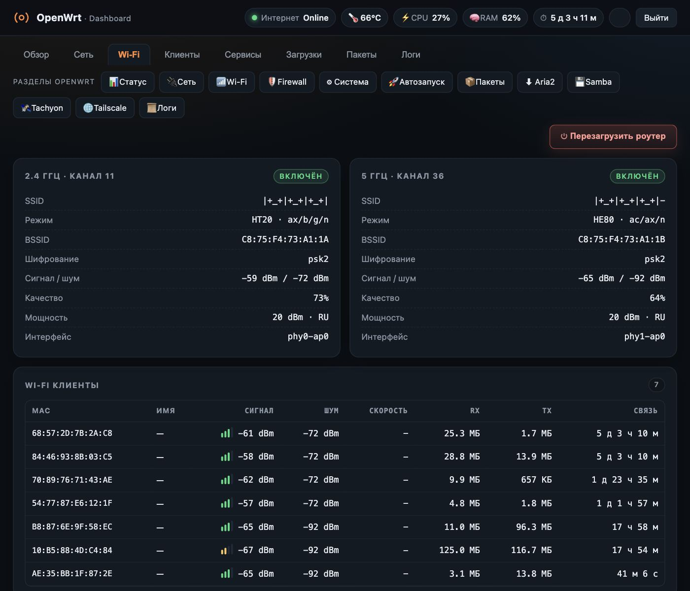
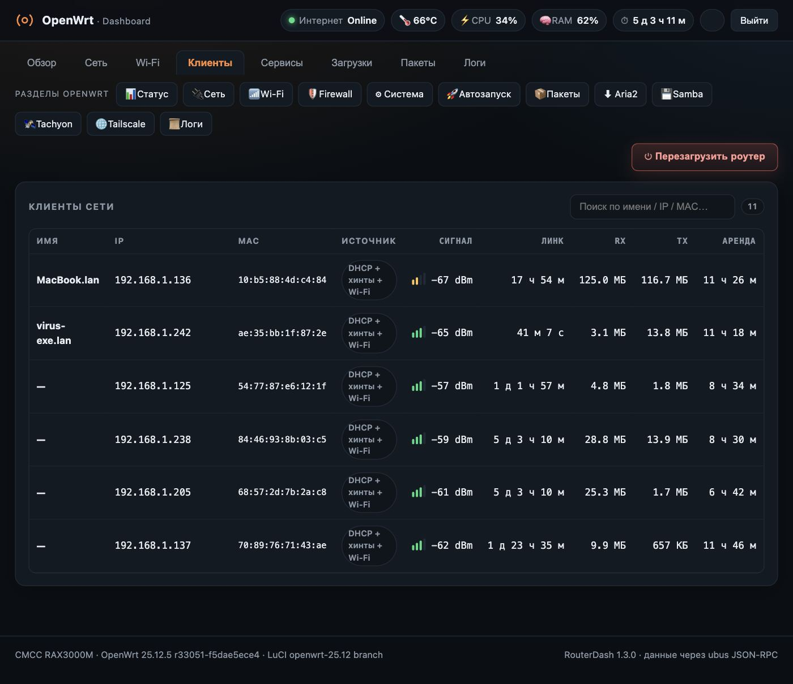
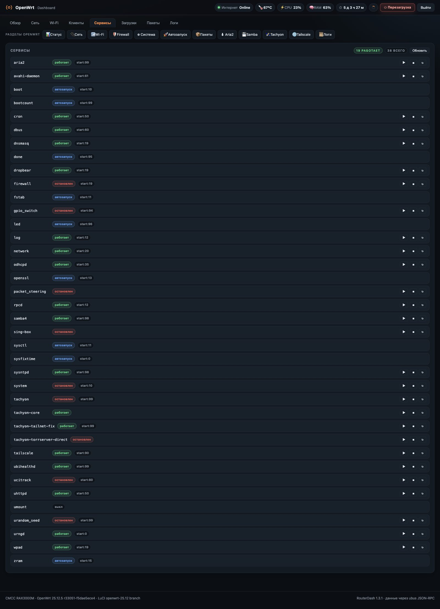
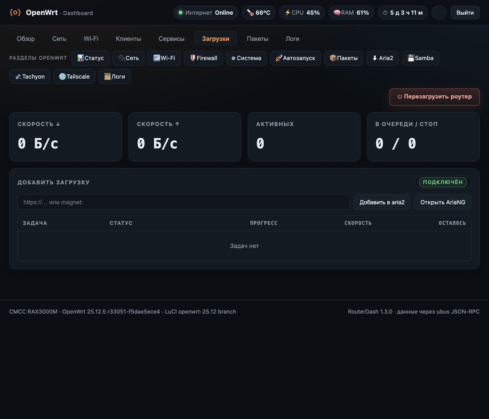
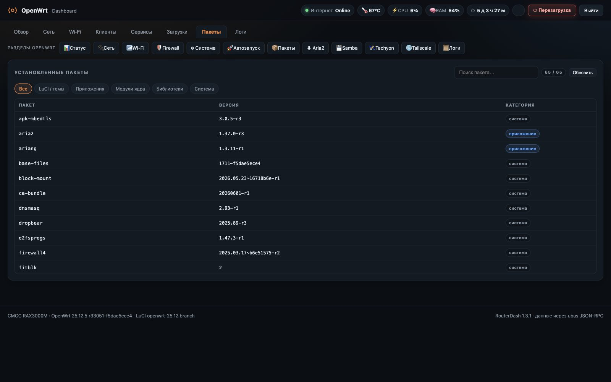
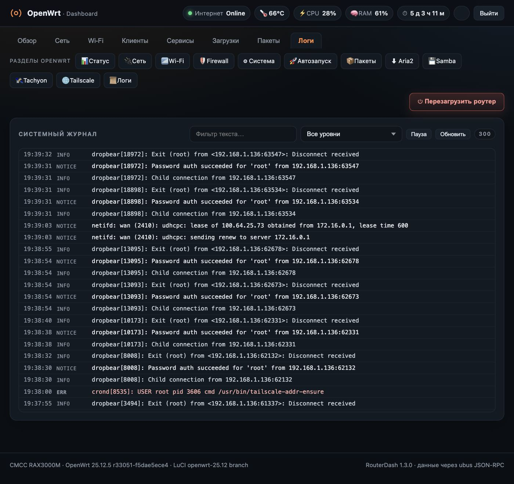

# RouterDash — a modern dashboard for OpenWrt

[](https://github.com/pozakonstantin-sketch/luci-app-routerdash/actions/workflows/build.yml)
[](https://github.com/pozakonstantin-sketch/luci-app-routerdash/releases)
[](LICENSE)

**RouterDash** is a responsive web dashboard for OpenWrt. It brings router health, network interfaces, Wi-Fi, connected clients, services, downloads, packages and system logs into one dark, compact interface.

> **Compatibility notice:** the current installer is an **APK v3** package for **OpenWrt 25.12 and later**. OpenWrt 24.10 and earlier use OPKG and IPK packages; this APK is not compatible with those releases.

[Русская документация](README.md) · [Installation](#installation) · [FAQ](docs/FAQ.md) · [Contributing](CONTRIBUTING.md) · [Report a bug](https://github.com/pozakonstantin-sketch/luci-app-routerdash/issues/new/choose)



## Features

- **Router health overview:** internet status, CPU, memory, temperature, load average, storage, connections and services.
- **Live metrics:** CPU, RAM, temperature, uptime and WAN status.
- **Network and Wi-Fi:** interfaces, wireless networks and connected clients.
- **Services and system log:** inspect service state and recent system messages.
- **Packages and downloads:** quick access to the corresponding LuCI sections.
- **VPN and tunnels:** status indicators for supported integrations when available on the device.
- **Responsive layout:** mobile-friendly controls and layouts for wider screens.
- **Careful polling:** sequential metric refresh; background polling pauses while the browser tab is hidden.
- **LuCI integration:** uses the existing LuCI session; RouterDash does not create a separate account.

## Screenshots

<details open>
<summary><b>Overview</b></summary>


</details>
<details>
<summary><b>Network</b></summary>


</details>
<details>
<summary><b>Wi-Fi</b></summary>


</details>
<details>
<summary><b>Clients</b></summary>


</details>
<details>
<summary><b>Services</b></summary>


</details>
<details>
<summary><b>Downloads</b></summary>


</details>
<details>
<summary><b>Packages</b></summary>


</details>
<details>
<summary><b>System log</b></summary>


</details>

## Requirements and compatibility

| Component | Requirement |
|---|---|
| OpenWrt | **25.12 or later** |
| Package manager | APK v3 |
| LuCI | `luci-base` installed |
| Package architecture | `noarch` |
| Browser | Modern JavaScript-enabled browser |

The package is marked `noarch` because it contains no architecture-specific executable. This does **not** mean every router model has been tested. Actual compatibility depends on available ubus methods, drivers and system metric sources. Please report your device model and firmware version in Issues to help build a tested compatibility matrix.

**Not supported by the current APK:** OpenWrt 24.10, 23.05 and older (OPKG/IPK). Supporting those releases requires a separate IPK build.

## Installation

1. Open [GitHub Releases](https://github.com/pozakonstantin-sketch/luci-app-routerdash/releases).
2. Download `luci-app-routerdash-*.apk` from the latest stable release.
3. Copy it to your router and install it:

```sh
scp luci-app-routerdash-*.apk root@192.168.1.1:/tmp/
ssh root@192.168.1.1 "apk add --allow-untrusted /tmp/luci-app-routerdash-*.apk"
```

Replace `192.168.1.1` with your router's address.

Release APK files are not signed with an OpenWrt package key, so `--allow-untrusted` is required for local installation. As with any third-party package installed as root, review the source code and release contents before installing it.

Open your router's address in a browser after installation. If you do not have an active LuCI session, the standard LuCI login page is shown first. The dashboard is also available directly at `/dashboard.html` and from the LuCI menu.

> The installer makes RouterDash the start page and backs up the previous `/www/index.html`. A normal package removal restores that backup. Back up your configuration before installing on systems with a customized web root.

## Upgrade

Download the newer APK from Releases, copy it to the router and run the same installation command:

```sh
scp luci-app-routerdash-*.apk root@192.168.1.1:/tmp/
ssh root@192.168.1.1 "apk add --allow-untrusted /tmp/luci-app-routerdash-*.apk"
```

## Uninstall

```sh
ssh root@192.168.1.1 "apk del luci-app-routerdash"
```

The package restores the backed-up start page if the installer created one.

## Build from source

Python 3.11+ is required. The current APK builder does not require the OpenWrt SDK:

```sh
cd package
python3 build-apk.py
```

The package is written to `package/dist/`. The builder copies the canonical dashboard source from the repository-root `dashboard.html`.

## Bug reports

Please check the [FAQ](docs/FAQ.md) first. When opening an Issue, include:

- router model and output of `ubus call system board`;
- RouterDash version;
- expected behaviour and what actually happened;
- relevant `logread` messages;
- a screenshot or browser-console error for visual issues.

Do not post passwords, LuCI tokens, public IP addresses or other secrets. Redact sensitive values from logs before submitting them.

## Contributing

Pull Requests are welcome. Please read [CONTRIBUTING.md](CONTRIBUTING.md) first. Testing on different SoCs, OpenWrt versions, browsers and LuCI configurations is especially valuable.

## License

RouterDash is released under the [MIT License](LICENSE).
