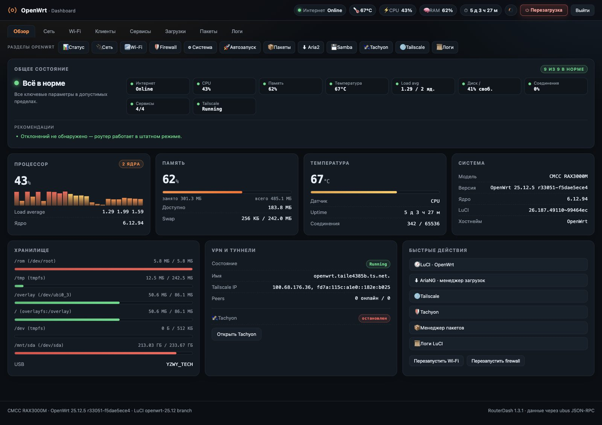
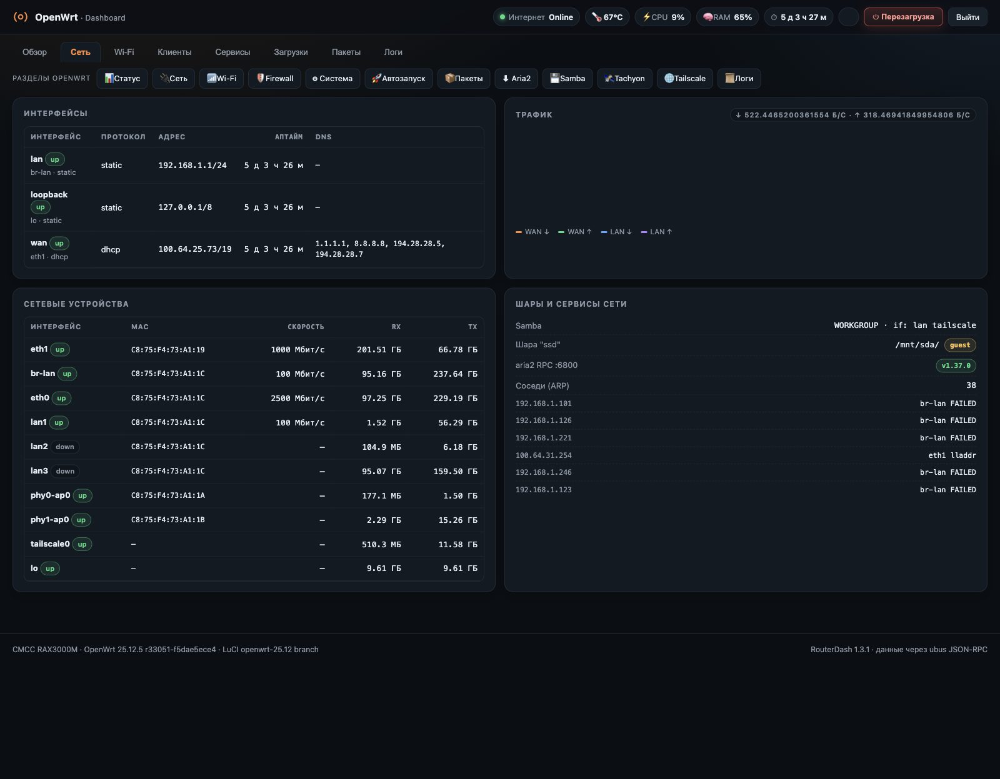
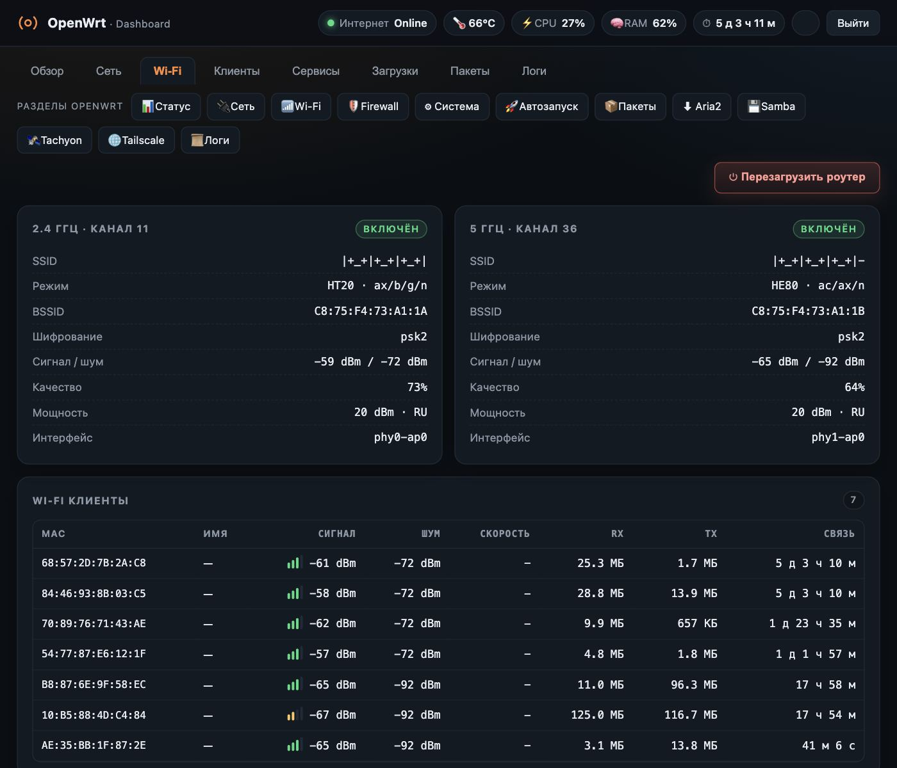
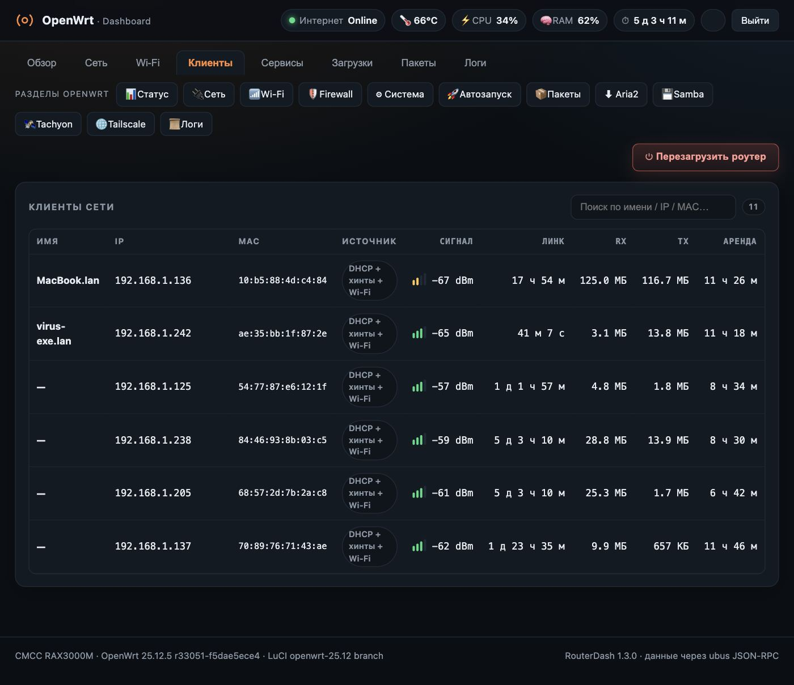
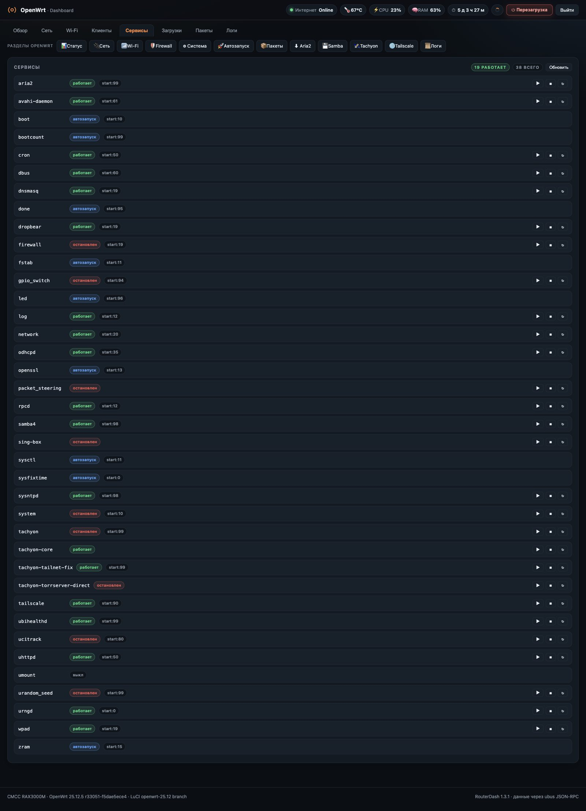
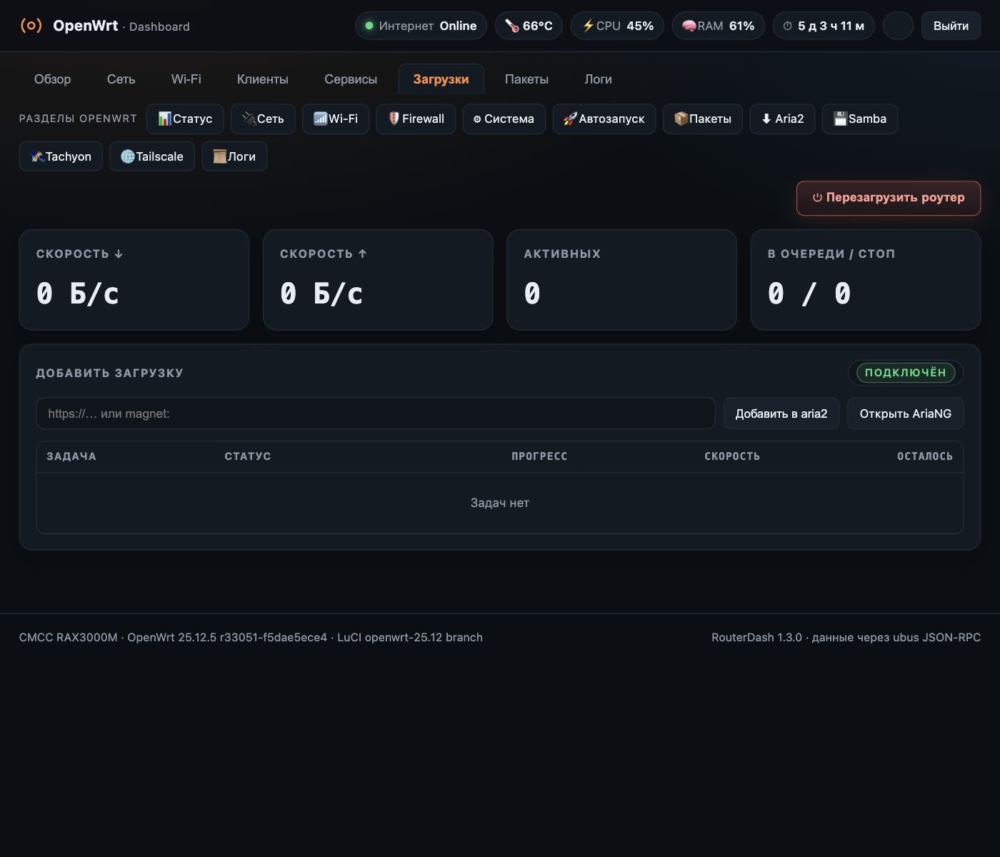
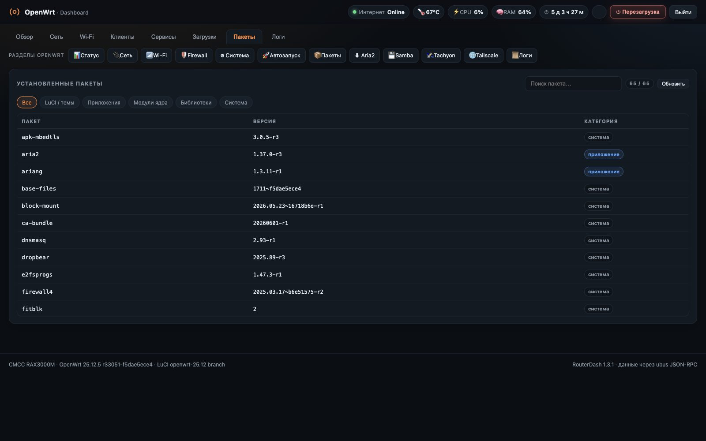
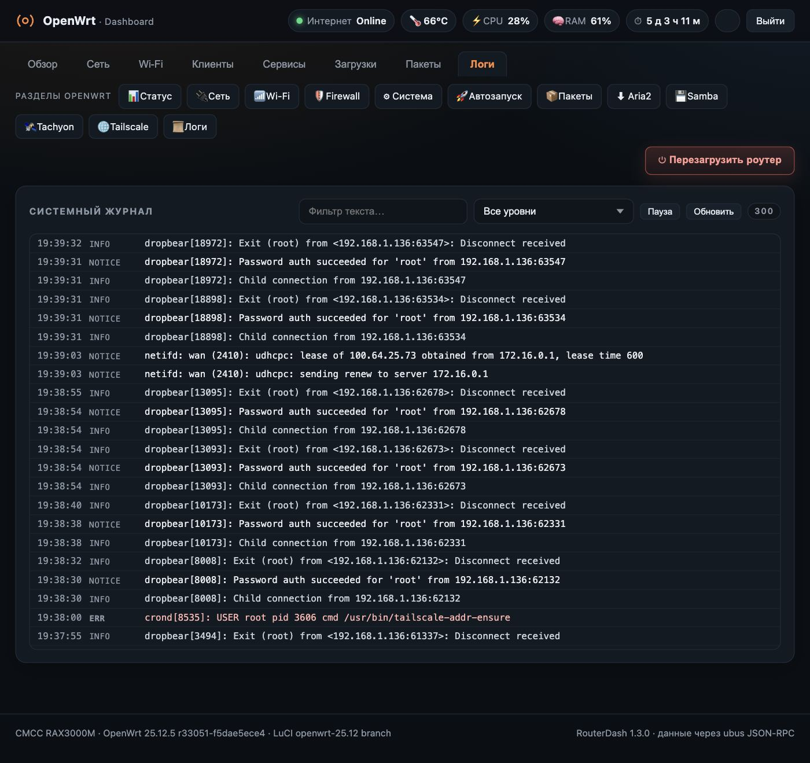

# RouterDash — дашборд OpenWrt

[](https://github.com/pozakonstantin-sketch/luci-app-routerdash/actions/workflows/build.yml)
[](https://github.com/pozakonstantin-sketch/luci-app-routerdash/releases)

Тёмный дашборд для OpenWrt. Ставится одним `.apk`-пакетом
на любой роутер с OpenWrt 24.10+ и LuCI, работает на ARM, MIPS и x86.



## Возможности

- **Адаптивный интерфейс**: компактная сетка для телефонов, удобные сенсорные элементы и горизонтальная прокрутка таблиц.
- **Экономный опрос**: обновление раз в 8 секунд, остановка фонового опроса при скрытой вкладке и отсутствие параллельных циклов.
- **Безопаснее управление службами**: проверка имён служб и экранирование динамических значений перед выводом.

- **8 вкладок**: обзор, сеть, Wi-Fi, клиенты, сервисы, загрузки, пакеты, логи.
- **Общее состояние роутера**: одна карточка со сводкой по интернету, CPU, памяти,
  температуре, load average, диску, соединениям и службам — с рекомендациями,
  если какой-то параметр вышел за пределы нормы.
- **Живые метрики**: CPU, RAM, температура, аптайм, статус интернета.
- **Быстрые переходы** в разделы LuCI и отдельная кнопка перезагрузки.
- **VPN и туннели**: состояние Tailscale и Tachyon в одной карточке.
- **Авторизация через LuCI** — отдельный пароль не нужен.
- **Не зависит от темы оформления**: логотип встроен, а CPU/температура/WAN
  берутся из стандартных источников, если модуль мониторинга недоступен.
- **Дашборд как главная страница**: `/` открывает дашборд, старая главная
  сохраняется и возвращается при удалении пакета.

## Android-приложение

Исходники Android-приложения находятся в [android-app](android-app/README.md). Материалы публикации в Google Play и RuStore, политика конфиденциальности и инструкция подписи находятся в [docs/store](docs/store/).
Нативное приложение на Kotlin/Jetpack Compose подключается напрямую к LuCI JSON-RPC/ubus, без WebView. Для сборки нужны Android Studio, JDK 17 и Android SDK Platform 36. Релизные сборки APK/AAB подписываются отдельным GitHub Actions workflow после настройки ключа подписи.

## Скриншоты разделов

<details open>
<summary><b>Обзор</b></summary>


</details>

<details>
<summary><b>Сеть</b></summary>


</details>

<details>
<summary><b>Wi-Fi</b></summary>


</details>

<details>
<summary><b>Клиенты</b></summary>


</details>

<details>
<summary><b>Сервисы</b></summary>


</details>

<details>
<summary><b>Загрузки</b></summary>


</details>

<details>
<summary><b>Пакеты</b></summary>


</details>

<details>
<summary><b>Логи</b></summary>


</details>

## Требования

- OpenWrt **24.10 или новее** (пакетный менеджер `apk`);
- установленный **LuCI** (`luci-base`) — через него проходит вход;
- на OpenWrt 23.05 и ниже (`opkg`) пакет не подойдёт.

Архитектура пакета — `noarch`, поэтому он один для всех роутеров.

## Установка

Скачайте `.apk` со страницы [Releases](../../releases), скопируйте на роутер
и установите:

```sh
scp luci-app-routerdash-*.apk root@192.168.1.1:/tmp/
ssh root@192.168.1.1 "apk add --allow-untrusted /tmp/luci-app-routerdash-*.apk"
```

Пакет не подписан, поэтому нужен флаг `--allow-untrusted` — только для
этого файла.

После установки откройте `http://192.168.1.1/`: откроется дашборд, а если
сессии LuCI ещё нет — штатная форма входа.

Дашборд также доступен по адресу `/dashboard.html` и через меню LuCI
(пункт **«Дашборд»**, первый в списке).

## Обновление

```sh
scp luci-app-routerdash-*.apk root@192.168.1.1:/tmp/
ssh root@192.168.1.1 "apk add --allow-untrusted /tmp/luci-app-routerdash-*.apk"
```

`apk` сам обновит пакет до новой версии, стартовая страница останется
настроенной.

## Удаление

```sh
ssh root@192.168.1.1 "apk del luci-app-routerdash"
```

Файлы дашборда удаляются, а прежняя главная страница восстанавливается из
`/www/index.html.routerdash-backup`.

## Сборка из исходников

Нужен только Python 3 — OpenWrt SDK не требуется: скрипт собирает формат
APK v3 (ADB) самостоятельно.

```sh
cd package
python3 build-apk.py
```

Результат: `package/dist/luci-app-routerdash-<version>.apk`.

Единственный источник дашборда — `dashboard.html` в корне репозитория;
при сборке он копируется в дерево пакета.

### Структура репозитория

```
dashboard.html                     сам дашборд (HTML + CSS + JS)
package/build-apk.py               сборщик .apk без SDK
package/files/                     файлы, попадающие на роутер
package/scripts/                   post-install / post-upgrade / post-deinstall
package/README.md                  краткая инструкция по пакету
docs/screens/                      скриншоты разделов
.github/workflows/                 CI: сборка apk и релизы
```

## Как это работает

- `www/dashboard.html` — статическая страница, которую отдаёт uhttpd.
- Все данные берутся через ubus JSON-RPC через `/cgi-bin/luci/admin/ubus`,
  поэтому используется уже открытая сессия LuCI. Запросы выполняются
  последовательно, чтобы не перегружать rpcd.
- `luci.controller.dashboard` добавляет маршрут `/cgi-bin/luci/admin/dashboard`,
  а `menu.d/dashboard.json` — пункт меню.

## Лицензия

MIT — см. [LICENSE](LICENSE).

---

**Документация:** [Wiki](https://github.com/pozakonstantin-sketch/luci-app-routerdash/wiki) ·
[FAQ](docs/FAQ.md) · [Changelog](CHANGELOG.md) · [Как помочь](CONTRIBUTING.md)
